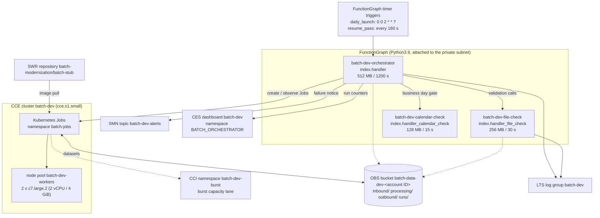

# Serverless Batch Orchestration for Mainframe Modernization on Huawei Cloud

[](LICENSE)
[](https://www.huaweicloud.com)

> A reproducible Huawei Cloud best-practice sample. This file is the English document; the Chinese version is [README.md](README.md).

---

## Overview

End-of-day batch still runs as job chains in many estates: one job normalises a landed extract, two jobs consume its output in parallel, a final job merges the two branches into the settlement. Modernising that workload is not hard because of any single job — it is hard because of the **orchestration**: which job waits for which, whether today is a processing day, whether the input file of a step has arrived yet, how a chain converges after one step fails, and how an execution that lasts hours survives a function invocation that lasts minutes.

This sample ships a complete, deployable answer:

- **FunctionGraph** carries the orchestration layer and the validation layer — three functions in total. The orchestrator drives the chain one pass per invocation and keeps run state in an OBS checkpoint object, so a long batch run and a short function execution stop conflicting.
- **CCE (Cloud Container Engine)** runs the batch containers as Kubernetes Jobs; runs that exceed the node pool are absorbed by a **CCI (Cloud Container Instance)** namespace.
- **OBS (Object Storage Service)** is the data lake — landed files, intermediate datasets, results, run checkpoints and function code packages — and the only shared contract between the orchestrator and the containers.
- **LTS, SMN and CES** provide logs, failure notices and run observability.

**Problem it solves**: the implicit logic of "scheduler plus file watcher plus an engineer watching the night batch" becomes versioned function code and declarative infrastructure that can be replayed and regression tested.

**Who it is for**: platform engineers, SREs and batch owners who need to run an end-of-day job chain on Huawei Cloud, or who want a serverless orchestration layer driving container jobs.

**The chain itself**: `JOB1` (normalise the landed extract) → `JOB2A` (fee calculation) and `JOB2B` (rebate calculation) in parallel → `JOB3` (merge and settle). The dependencies are declared as data in `src/functions/orchestrator/plan.py`, so changing the chain does not change the orchestration logic.

---

## Contents

- [Architecture](#architecture)
- [Highlights](#highlights)
- [Huawei Cloud services used](#huawei-cloud-services-used)
- [Prerequisites](#prerequisites)
- [Quick start](#quick-start)
- [Step-by-step deployment](#step-by-step-deployment)
- [Usage and verification](#usage-and-verification)
- [Clean up](#clean-up)
- [Further reading](#further-reading)
- [FAQ and troubleshooting](#faq-and-troubleshooting)
- [License](#license)
- [Contact and maintainers](#contact-and-maintainers)

**Repository layout**

```text
.
├── docs/                    architecture notes and deployment guide
├── infra/                   Terraform root module (huaweicloud provider)
├── src/                     functions, batch container, Kubernetes manifests
├── scripts/                 function code package builder
├── README.md                Chinese document
└── LICENSE                  MIT No Attribution
```

---

## Architecture



**Reading the diagram**

1. **Two timer triggers are the only entry points.** `daily_launch` uses a six-field cron (second minute hour day month weekday), `0 0 2 * * ?` by default, and carries `{"action":"start_run"}`. `resume_pass` is a Period trigger whose interval comes from `resume_interval_seconds` (180 by default) and carries `{"action":"resume_runs"}`. The first opens the daily run, the second advances whichever runs are in flight.
2. **The orchestrator does not run jobs, it drives them.** It calls the two validation functions for decisions, creates Jobs through the cluster API, polls each Job until the container reports an exit code, and routes that code into either the next steps or a convergence. The four-step chain is spread across passes, each of which finishes inside its own time budget.
3. **State lives entirely in OBS.** Each run owns one `runs/<run-id>.json` checkpoint recording every step's phase, job name, attempt count and failure reason. A timeout, a restart or a redeploy loses no progress.
4. **OBS is the only data-plane meeting point.** Containers read `inbound/transactions/` and write `processing/<step>/output/` and `outbound/`; the orchestrator applies the same prefixes when it asks whether an input is ready, so "has the file landed" gets one answer from both sides.
5. **The network is private end to end.** The stack sits in two cross-availability-zone private subnets with no NAT gateway and no elastic IP on the data path. Regional services are reached at port 443 over the internal service network block `100.125.0.0/16`, and the security group is the single enforcement point.

---

## Highlights

1. **Long batch runs are decoupled from the function execution limit.** One orchestration pass gets a budget from `stage_budget_seconds` (900 by default); when it runs out the run is left on its checkpoint and the next periodic pass continues it. The function timeout is `stage_budget_seconds + 300`, i.e. 1200 seconds, leaving room to close the pass.
2. **The business day gate and the input gate are separate functions.** `calendar_check` decides whether today is a processing day — the weekend always is not, further dates are read from `calendars/non-processing-days.json` in OBS, and an absent object leaves the weekend rule standing on its own, which is the normal state of a fresh deployment rather than a fault. `file_check` decides whether a step's inputs are present and, for landed data, recent within `max_input_age_days` (2 UTC calendar days by default).
3. **Failures are reported, never absorbed.** A non-zero container exit, an unreachable validation function, a cluster call that keeps being refused and a job that stops reporting each end as a failed step carrying its reason, plus the tail of the container log where the cluster has one. The reason with the most explanatory weight wins, so a genuine container failure is never recorded as a missing input file behind it. Platform-side reasons (`DeadlineExceeded`, `PodEvicted`) are retried rather than failed.
4. **Regression runs are physically isolated from production.** A `run_regression` pass moves the whole read/write scope under `runs/<run-id>/`, skips the business day gate and accepts modules in any order. A test run cannot read, and cannot overwrite, the production dataset.
5. **Concurrency is declared, not discovered.** The node pool is fixed at 2 nodes; a job requests `500m` CPU and is capped at 1 core, so exactly two job slots fit on a node. Parallel branches are bounded by `Plan.slots_free()` against the in-flight job count, and regression concurrency comes from `regression_max_concurrency` (3 by default).
6. **No key material reaches the code.** Functions take short-lived credentials through a FunctionGraph agency; nodes take theirs through a CCE agency, so there is no image pull secret and no OBS key mounted into a pod. The bucket policy authorises the agencies by name, block-public-access is on across all four dimensions, and a policy statement denies non-TLS requests.
7. **Reproducible code packages.** `scripts/package_functions.py` fixes entry order, timestamps and permission bits, so the same source builds byte-identical archives. Before writing anything it compiles every source file, asserts each handler is defined, asserts `index.py` sits at the archive root, and **compares the produced path character by character against the `source` declared in `infra/functions.tf`**, failing the build on any drift.

---

## Huawei Cloud services used

| Service | Role in this sample | Resources created here |
|-|-|-|
| **FunctionGraph (FGS)** | Runtime for the orchestration and validation layers; timer triggers provide the schedule | Functions `batch-dev-orchestrator`, `batch-dev-file-check`, `batch-dev-calendar-check`; triggers `daily_launch` (Cron) and `resume_pass` (Period) |
| **Cloud Container Engine (CCE)** | Private cluster hosting the batch containers | Cluster `batch-dev` (`cce.s1.small`, `overlay_l2` container network, timezone `UTC+08:00`); node pool `batch-dev-workers` |
| **Cloud Container Instance (CCI)** | Burst capacity lane beyond the node pool | Namespace `batch-dev-burst` (`general-computing`); per-pod network `batch-dev-burst-network` and subnet `batch-dev-pod-subnet` |
| **Object Storage Service (OBS)** | Data lake, checkpoint store and function code package store | Bucket `batch-data-<environment>-<account ID>` (versioned, AES256 at-rest encryption, private), block-public-access, bucket policy, two lifecycle rules, two code package objects |
| **Log Tank Service (LTS)** | Log sink for all three functions | Group `batch-dev`; streams `batch-dev-orchestrator`, `batch-dev-validation`; retention from `log_retention_days` (30 by default) |
| **Simple Message Notification (SMN)** | Failure notices and alarm notifications | Topic `batch-dev-alerts`; an `email` subscription when `notification_email` is not empty |
| **Cloud Eye Service (CES)** | Custom metric namespace and operations dashboard | Dashboard `batch-dev`; widgets `Failed runs` (bar) and `Run duration in seconds` (line); two alarm rules when `enable_ces_alarms` is turned on |
| **Software Repository for Container (SWR)** | Private repository for the batch job image | Organization `batch-modernization`; private repository `batch-stub` |
| **VPC, subnets and security group** | Private network boundary of the whole stack | VPC `batch-dev-vpc` (`10.20.0.0/16`); subnets `batch-dev-subnet-a` (cn-north-4a) and `batch-dev-subnet-b` (cn-north-4b); security group `batch-dev-jobs-sg` with seven rules |
| **Elastic IP (optional)** | Public reachability of the cluster API server only | `batch-dev-api-eip` and bandwidth `batch-dev-api-bandwidth` (5 Mbit/s by default) exist only when `enable_api_server_public_access` is `true`; off by default |
| **Identity and Access Management (IAM) agencies** | Delegated, short-lived credentials for the data plane | Agency `batch-dev-functions-agency` (delegated service `op_svc_cff`), agency `batch-dev-cluster-agency` (delegated domain `op_svc_cce`) |

**On the burst lane and the public entry point**: `enable_api_server_public_access` is `false` by default, so the shipped topology is reachable from inside the VPC only. `enable_ces_alarms` is `false` by default — alarm rules bound to a custom metric namespace have to be created on the Cloud Eye side with the same metric, dimension and threshold, which makes them an explicitly opt-in part of the stack. The dashboard and the custom metric reporting itself (`enable_custom_metrics`, `true` by default) are unaffected.

---

## Prerequisites

**Account and permissions**

- A Huawei Cloud account with FunctionGraph, CCE, CCI, OBS, LTS, SMN, CES, SWR, VPC and IAM enabled.
- The operator needs permission to create those resources. Both agencies are created by the stack:
  - `batch-dev-functions-agency` → delegated service `op_svc_cff`; account-scoped role `OBS Administrator`; project-scoped roles `SMN FullAccess` and `CES FullAccess` in `cn-north-4`, extendable through `agency_extra_roles`.
  - `batch-dev-cluster-agency` → delegated domain `op_svc_cce`; project-scoped roles `OBS OperateAccess`, `SWR Admin` and `CCE Admin` in `cn-north-4`.
- Obtain your Access Key ID and Secret Access Key from the Huawei Cloud "My Credentials" page and put them into the deployment scripts. Do not write credentials into code or commit them to a repository.

**Tooling and versions**

| Tool | Requirement |
|-|-|
| Terraform | `>= 1.5.0` (`infra/versions.tf`) |
| huaweicloud provider | `1.96.1` (`infra/versions.tf`) |
| Python | 3.9 or newer locally; the function runtime is pinned to `Python3.9` |
| kubectl | matching the cluster version, used to apply `src/manifests/` |
| Docker (or an equivalent container builder) | to build and push the batch job image |

**Region and availability zone constraints**

- The region is pinned to `cn-north-4` in `infra/locals.tf`; every endpoint, availability zone and timezone in the stack is expressed for that region.
- The two subnets sit in `cn-north-4a` (`subnet_a_az`) and `cn-north-4b` (`subnet_b_az`); the CCI per-pod network is in `cn-north-4b`.
- The cluster timezone is `UTC+08:00`; the business day decision uses the IANA zone from `schedule_timezone` (`Asia/Shanghai` by default).
- The endpoint suffix comes from `cloud` (`myhuaweicloud.com` by default).

**Deployment inputs** — the full list is in `infra/variables.tf`, a worked sample in `infra/terraform.tfvars.example`.

| Variable | Type | Default | Notes |
|-|-|-|-|
| `access_key` / `secret_key` | string | `""` | leave empty to read `HW_ACCESS_KEY` / `HW_SECRET_KEY` from the environment |
| `environment` | string | `dev` | appears in resource names and the bucket name; regex `^[a-z][a-z0-9-]{1,15}$` |
| `name_prefix` | string | `batch` | common prefix, also determines the metric namespace |
| `notification_email` | string | `""` | empty means no subscription; the topic is created either way |
| `agency_extra_roles` | list(string) | `[]` | extra project-scoped roles on the function agency |
| `vpc_cidr` / `subnet_a_cidr` / `subnet_b_cidr` | string | `10.20.0.0/16` / `10.20.1.0/24` / `10.20.2.0/24` | private network |
| `container_network_cidr` / `service_network_cidr` | string | `172.16.0.0/16` / `10.254.0.0/16` | pod network and ClusterIP range |
| `cluster_spec` | string | `cce.s1.small` | cluster specification; `cce.s1.small` supports up to 50 nodes |
| `node_flavor` | string | `c7.large.2` | worker flavor: 2 vCPU / 4 GiB, x86_64 |
| `node_count` | number | `2` | fixed pool size, matching two concurrent job slots |
| `node_os` | string | `Huawei Cloud EulerOS 2.0` | node operating system |
| `node_root_volume_size` / `node_root_volume_type` | number / string | `40` / `SAS` | system disk size (GiB) and disk category |
| `node_data_volume_size` / `node_data_volume_type` | number / string | `100` / `SAS` | data disk size (GiB) and category, holds the image cache |
| `node_pool_key_pair` / `node_password` | string | `""` / `""` | **exactly one is required** — enforced by a `precondition` in `cce.tf` |
| `enable_api_server_public_access` | bool | `false` | attach an elastic IP to the API server |
| `api_server_bandwidth_mbitps` | number | `5` | used only when public access is on |
| `cci_enabled` | bool | `true` | create the burst capacity lane |
| `cci_namespace_type` | string | `general-computing` | namespace type |
| `cci_pod_network_cidr` | string | `10.20.3.0/24` | per-pod network subnet |
| `cci_warmup_pool_size` | number | `10` | pre-allocated addresses, valid range 1–500 |
| `swr_organization` / `swr_repository` / `swr_image_tag` | string | `batch-modernization` / `batch-stub` / `1.0.0` | the three parts of the image address |
| `lifecycle_transition_days` | number | `30` | days before intermediate datasets move to the infrequent access class; also the age at which superseded code package versions expire |
| `log_retention_days` | number | `30` | retention of the log group and streams |
| `schedule_timezone` | string | `Asia/Shanghai` | timezone the business day rule is evaluated in |
| `daily_cron` | string | `0 0 2 * * ?` | six-field cron: second minute hour day month weekday |
| `resume_interval_seconds` | number | `180` | interval of the checkpoint resumption pass, in seconds |
| `max_input_age_days` | number | `2` | maximum accepted age of a landed file, in UTC calendar days |
| `stage_budget_seconds` | number | `900` | time budget of one orchestration pass |
| `job_deadline_seconds` | number | `7200` | hard deadline of one container run, written to `activeDeadlineSeconds` |
| `job_cpu_request` / `job_memory_request` | string | `500m` / `1Gi` | container requests |
| `job_cpu_limit` / `job_memory_limit` | string | `1` / `2Gi` | container limits |
| `regression_max_concurrency` | number | `3` | modules executed at the same time in a regression run |
| `job_namespace` | string | `batch-jobs` | namespace holding the batch jobs |
| `k8s_api_server` / `k8s_ca_cert` / `k8s_service_account_token` | string | `""` | **leave empty on the first apply**, fill them once the cluster exists |
| `enable_ces_alarms` | bool | `false` | custom metric alarm rules are opt-in |
| `enable_custom_metrics` | bool | `true` | whether the orchestration layer publishes the run counters |
| `duration_alarm_threshold_seconds` | number | `1800` | turnaround threshold of the duration alarm |
| `failure_alarm_suppression_minutes` | number | `15` | one of `0/5/10/15/30/60/180/360/720/1440` |

---

## Quick start

> This is a **two-apply** deployment. The first apply creates the cluster; in between you apply the namespace, RBAC and ConfigMap with kubectl and read three cluster access values back; the second apply writes them into the orchestrator. There is no single-command path — follow the order below.

**Manual prerequisite before anything else: build and push the batch image.** `infra/locals.tf` composes `batch_image` from `huaweicloud_swr_organization.main.login_server`, and the Job `image` field references it. `infra/swr.tf` creates the SWR organization and the private repository only — **it neither builds nor pushes an image**. Without a matching tag in the repository the jobs sit in `ImagePullBackOff`.

```bash
# 0) credentials (from the Huawei Cloud "My Credentials" page; never commit them)
export HW_ACCESS_KEY=<HW_ACCESS_KEY>
export HW_SECRET_KEY=<HW_SECRET_KEY>

# 1) offline checks (no cloud contact)
python -m pytest src/functions -q
python scripts/package_functions.py
cd infra && terraform validate && cd ..

# 2) build and push the batch image (<registry host> = terraform output image_registry_host)
docker login <registry host>
docker build -t <registry host>/batch-modernization/batch-stub:1.0.0 src/job
docker push <registry host>/batch-modernization/batch-stub:1.0.0

# 3) deployment inputs
cd infra
cp terraform.tfvars.example terraform.tfvars   # then set the node sign-in value
terraform init
terraform apply                                 # first apply: creates the cluster, k8s_* left empty

# 4) in-cluster objects (30-batch-job-template.yaml is a template: never apply it)
kubectl apply -f ../src/manifests/00-namespace.yaml \
              -f ../src/manifests/10-rbac.yaml \
              -f ../src/manifests/20-batch-config-configmap.yaml
kubectl -n batch-jobs create secret generic batch-obs-credentials \
  --from-literal=HW_ACCESS_KEY=<HW_ACCESS_KEY> \
  --from-literal=HW_SECRET_KEY=<HW_SECRET_KEY>

# 5) read the three cluster access values back into terraform.tfvars
../src/job/export_k8s_access.sh

# 6) second apply
terraform apply
terraform output next_step_inputs
```

---

## Step-by-step deployment

### Step 1 — Offline checks

All three commands stay local and should pass before any resource is requested.

```bash
python -m pytest src/functions -q
```

Expected last line:

```text
292 passed in 0.64s
```

```bash
python scripts/package_functions.py
```

Expected output:

```text
函数代码包构建完成：
  orchestrator  infra/.build/batch-orchestrator.zip      20 个条目   42.4 KiB  sha256 fa81bffe1468
  checks        infra/.build/batch-checks.zip            20 个条目   42.4 KiB  sha256 52b683323878
根目录入口：index.py（处理器名见 infra/functions.tf）
```

The builder prints in Chinese. Its two archives are read back by `infra/functions.tf` through `local.build_dir` (defined in `infra/locals.tf` as `${path.module}/.build`) as the `source` of the `huaweicloud_obs_bucket_object` resources; the packages are uploaded to OBS first and handed to the functions with `code_type = "obs"`. To build one of them: `python scripts/package_functions.py --only orchestrator`.

```bash
cd infra
terraform validate
```

`terraform validate` is a local check and needs the provider plugins available (run `terraform init` first, or point at a local plugin cache). Expected:

```text
Success! The configuration is valid, but there were some validation warnings as shown above.
```

### Step 2 — Build and push the batch image (manual prerequisite)

The build context is `src/job/`. The `Dockerfile` starts `FROM python:3.11-slim`, runs unprivileged as UID/GID `10001`, and `entrypoint.sh` turns the step name passed by the Job into `python3 -m batch_job <STEP>`. The exit status of that program is the exit status of the container, and the orchestrator routes the chain on it.

```bash
docker build -t <registry host>/batch-modernization/batch-stub:1.0.0 src/job
docker login -u <user> -p <SWR access key> <registry host>
docker push <registry host>/batch-modernization/batch-stub:1.0.0
```

The three address segments come from `swr_organization`, `swr_repository` and `swr_image_tag`; they must match `terraform.tfvars`, otherwise the jobs pull a different tag. Read `<registry host>` after the first apply with `terraform output image_registry_host`.

### Step 3 — Prepare `terraform.tfvars`

```bash
cd infra
cp terraform.tfvars.example terraform.tfvars
```

`terraform.tfvars` is ignored by both the root `.gitignore` and `infra/.gitignore`. Confirm three things:

1. **Give the nodes a sign-in method**: `node_pool_key_pair` (the name of an already imported key pair, never a public key string) or `node_password` — one of the two. `export TF_VAR_node_password="<node password>"` works as well. With both empty, the `precondition` on `huaweicloud_cce_node_pool.workers` fails at plan time with `Set node_pool_key_pair or node_password: worker nodes require one of the two.`
2. **Leave `k8s_api_server`, `k8s_ca_cert` and `k8s_service_account_token` empty** — the first apply does not fill them.
3. Set `notification_email` (for example `notification_email = "<EMAIL>"`) if an operator mailbox should receive failure notices. Empty means no subscription is created; the topic exists either way and alarms can still publish into it.

### Step 4 — First apply: create the cluster

```bash
terraform init
terraform apply
```

Terraform prints `Plan: <N> to add, 0 to change, 0 to destroy.`, and after confirmation ends with `Apply complete! Resources: <N> added, 0 changed, 0 destroyed.` The cluster, node pool, VPC, OBS bucket, SWR repository, functions and triggers now exist; `K8S_API_SERVER` and friends are still empty strings inside the function.

> Cluster and node pool creation takes several minutes. If an orchestration pass fires while the first apply is running it reports `the batch containers cannot be started: ... was never named to this function`; that is expected and disappears once the values are filled in.

### Step 5 — Configure kubectl and apply the in-cluster objects

Download the kubeconfig from the CCE console under the cluster's connection information and point `KUBECONFIG` at it (or merge it into `~/.kube/config`).

```bash
kubectl apply -f ../src/manifests/00-namespace.yaml
kubectl apply -f ../src/manifests/10-rbac.yaml
kubectl apply -f ../src/manifests/20-batch-config-configmap.yaml
```

Expected:

```text
namespace/batch-jobs created
serviceaccount/batch-orchestrator created
serviceaccount/batch-job-runner created
role.rbac.authorization.k8s.io/batch-orchestrator created
rolebinding.rbac.authorization.k8s.io/batch-orchestrator created
secret/batch-orchestrator-token created
configmap/batch-config created
```

**`30-batch-job-template.yaml` is a per-run template and is never applied directly.** The placeholders `__JOB_NAME__`, `__NAMESPACE__`, `__RUN_ID__`, `__TASK__`, `__IMAGE__`, `__PREFIX__`, `__DEADLINE__`, `__TTL__` and `__CPU_REQUEST__` are filled field by field by the orchestration layer when it creates the Job — `Engine.job_body()` in `src/functions/orchestrator/index.py` produces exactly that structure. Editing or submitting the file by hand does not yield a runnable job.

The ConfigMap ships with `OBS_BUCKET: "REPLACE_ME"`, which has to become the real bucket name, otherwise the container stops at its own start-up check:

```text
OBS_BUCKET is empty: the batch-config map has no bucket
```

```bash
terraform output data_bucket        # take the real bucket name into the ConfigMap
kubectl apply -f ../src/manifests/20-batch-config-configmap.yaml
```

`batch-config` must carry the seven keys `OBS_BUCKET`, `OBS_ENDPOINT`, `OBS_REGION`, `INBOUND_PREFIX`, `PROCESSING_PREFIX`, `OUTBOUND_PREFIX` and `LOG_LEVEL` — the contract is listed as `CONFIG_MAP_KEYS` in `src/job/batch_job/settings.py`.

### Step 6 — Create the credential object the containers read

Job pods take the run's OBS keys from `batch-obs-credentials`, declared `optional: true`, so a namespace without it still starts the pod and the container reports the missing data access itself:

```text
no access key pair: create the batch-obs-credentials secret with the literals HW_ACCESS_KEY and HW_SECRET_KEY
```

```bash
kubectl -n batch-jobs create secret generic batch-obs-credentials \
  --from-literal=HW_ACCESS_KEY=<HW_ACCESS_KEY> \
  --from-literal=HW_SECRET_KEY=<HW_SECRET_KEY>
```

Expected: `secret/batch-obs-credentials created`

### Step 7 — Read the cluster access values back and fill them in

```bash
../src/job/export_k8s_access.sh
```

The script reads the API server address from the current kubeconfig, takes `data.token` and `data.ca.crt` from the `batch-jobs/batch-orchestrator-token` Secret (retrying every 2 seconds for up to 60 seconds while the token is not yet issued), decodes the JWT and asserts its subject is `system:serviceaccount:batch-jobs:batch-orchestrator`, then prints three paste-ready lines:

```text
k8s_api_server                = "https://<private-ip>:5443"
k8s_service_account_token     = "<JWT>"
k8s_ca_cert = <<-EOT
-----BEGIN CERTIFICATE-----
...
-----END CERTIFICATE-----
EOT
```

Copy them into `terraform.tfvars`. The token is long lived: do not commit it and do not paste it into tickets or chat tools. Overridable flags: `--namespace`, `--secret`, `--service-account`, `--api-server`, `--wait`.

### Step 8 — Second apply

```bash
terraform apply
```

This writes `K8S_API_SERVER`, `K8S_NAMESPACE`, `K8S_CA_CERT` and `K8S_SA_TOKEN` into the runtime configuration of the orchestrator; expect `Apply complete! Resources: 0 added, <N> changed, 0 destroyed.`

```bash
terraform output next_step_inputs
```

Expected:

```text
next_step_inputs = "k8s_api_server                = output.cluster_api_server
k8s_ca_cert                   = export_k8s_access.sh -> CA
k8s_service_account_token     = export_k8s_access.sh -> token"
```

---

## Usage and verification

### Smallest example: open one run by hand

In the FunctionGraph console, open `batch-dev-orchestrator` → function test, and submit:

```json
{
  "action": "start_run",
  "runDate": "2026-11-16",
  "budgetSeconds": 120
}
```

Expected answer (field names exactly as `Engine.handle()` builds them):

```json
{
  "action": "start_run",
  "kind": "manual",
  "passBudgetSeconds": 120,
  "passElapsedSeconds": 12.4,
  "budgetSpent": false,
  "runs": [
    {
      "runId": "batch-2026-11-16",
      "kind": "manual",
      "runDate": "2026-11-16",
      "status": "FAILED",
      "errorType": "INPUT_FILES_MISSING",
      "message": "4 step(s) never started: JOB1 (INPUT_FILES_MISSING), JOB2A (INPUT_FILES_MISSING), JOB2B (INPUT_FILES_MISSING), JOB3 (INPUT_FILES_MISSING)",
      "phases": { "JOB1": "skipped", "JOB2A": "skipped", "JOB2B": "skipped", "JOB3": "skipped" },
      "unfinished": [],
      "checkpoint": "runs/batch-2026-11-16.json",
      "notification": { "published": "<topic URN>" },
      "counters": {}
    }
  ]
}
```

`notification` carries the outcome of the failure notice: `{"published": "<topic URN>"}`, or `{"rejected": "<reason>"}` when the notification service refuses it, or `{"skipped": "no notification topic configured"}`. `counters` carries the reply of the Cloud Eye batch-report call and is `{}` when reporting is switched off or no namespace was resolved.

A fresh deployment has no landed file, so `INPUT_FILES_MISSING` is the correct first answer. The run identifier is the day, so launching again on the same day continues the run that is already open instead of starting a second one over the same data.

**Land an input file (pattern `^txns\.\d{8}\.csv$`):**

```bash
terraform output data_bucket
terraform output inbound_prefix
obsutil cp txns.20261116.csv obs://<bucket>/inbound/transactions/txns.20261116.csv
```

Run the same event again: `JOB1` moves to `running` and `phases` shows the job name `job-job1-batch-2026-11-16`. Watch it from the cluster side:

```bash
kubectl -n batch-jobs get jobs -l batch.job/run-id=batch-2026-11-16
kubectl -n batch-jobs logs -l batch.job/run-id=batch-2026-11-16 --tail=40
```

### Asking the two validation functions directly

`batch-dev-file-check` with `{"jobName": "JOB1"}`:

```json
{
  "step": "JOB1", "jobName": "JOB1", "allFilesPresent": true, "errorType": null,
  "bucket": "<bucket>", "prefix": "(production)",
  "filesChecked": 1, "missingCount": 0, "maxAgeDays": 2,
  "message": "Every input of JOB1 is present."
}
```

Accepted step names are `JOB1`, `job1` or `Check_JOB1_Input_Files`; an unknown name answers `errorType: "INPUT_FILES_INVALID"` together with `knownSteps`. Adding `"runId": "night-7"` moves the question into that run's namespace.

`batch-dev-calendar-check` with `{"runDate": "2026-11-16"}` (a Monday):

```json
{
  "isBusinessDay": true, "date": "2026-11-16", "reason": "business day",
  "timezone": "Asia/Shanghai", "calendar": "no calendar object"
}
```

`{"runDate": "2026-11-15"}` (a Sunday) returns `isBusinessDay: false` with `reason: "weekend"`. Once `calendars/non-processing-days.json` is uploaded, `calendar` becomes `"<N> non-processing date(s)"` and a listed date reports `reason: "non-processing date"`.

### An isolated regression run

```json
{ "action": "run_regression", "runId": "night-7", "modules": ["JOB1", "JOB3"] }
```

Regression runs skip the business day gate, accept modules in any order, and keep every read and write under the `runs/night-7/` prefix. Omitting `modules` raises and lists the known modules; a misspelled name comes back under `rejected` instead of silently succeeding. The parallel bound is `regression_max_concurrency`.

### Verification checklist

| What to check | Command or place | Expected |
|-|-|-|
| Unit and flow cases | `python -m pytest src/functions -q` | `292 passed` |
| Package paths align with the deployment | `python scripts/package_functions.py` | two archives, paths identical to `infra/functions.tf` |
| Configuration validity | `terraform validate` | `Success!` |
| Data bucket and endpoint | `terraform output data_bucket`, `terraform output object_storage_endpoint` | bucket name, plus `https://obs.cn-north-4.myhuaweicloud.com` |
| Function URNs | `terraform output orchestrator_function_urn` and its two siblings | `urn:fgs:...` |
| Schedule | `terraform output daily_schedule`, `terraform output resume_interval_seconds` | `0 0 2 * * ?` and `180` |
| Image address | `terraform output batch_image`, `terraform output image_registry_host` | `<login_server>/batch-modernization/batch-stub:1.0.0` |
| Burst lane | `terraform output burst_namespace`, `terraform output burst_network_id` | `batch-dev-burst` and the network id; empty strings when `cci_enabled = false` |
| Metric namespace | `terraform output metric_namespace` | `BATCH_ORCHESTRATOR` (letters, digits and underscores only) |
| Trigger state | FunctionGraph console | `daily_launch` and `resume_pass` both `ACTIVE` |
| Function logs | LTS group `batch-dev` | `batch-dev-orchestrator` shows `pass opened: action=...`; `batch-dev-validation` shows `file check answered: ...` |
| Jobs and pods | `kubectl -n batch-jobs get jobs` | names shaped `job-<step>-<run-id>`, labelled with `batch.job/run-id` |
| Checkpoints | `obsutil ls obs://<bucket>/runs/` | one `<run-id>.json` per run |
| Run observability | CES dashboard `batch-dev` | widgets `Failed runs` and `Run duration in seconds` carry points |
| Failure notice | SMN topic `batch-dev-alerts` (subscribed mailbox) | subject `batch-dev-orchestrator: run <runId> failed (<errorType>)` |

> **Once deployed, work through this section in the real environment**: confirm the chain runs end to end, checkpoints land in OBS, the failure notice arrives and the dashboard carries data. The sample is delivered only when those hold.

---

## Clean up

```bash
cd infra
terraform destroy
```

Before destroying, confirm nothing in the bucket still needs to be kept. The cluster is created with `delete_all = "true"`, so the node pool goes with it. The bucket is created with `force_destroy = true`, **which removes every object and every version in it** — export the results and checkpoints you want to keep first.

Release resources promptly so nothing is left behind. The namespace and RBAC objects from `src/manifests/` disappear with the cluster; the access keys inside `batch-obs-credentials` are best revoked on the console side as well. The two archives under `infra/.build/` are build products and can be recreated at any time with `python scripts/package_functions.py`.

---

## Further reading

- [docs/architecture.md](docs/architecture.md) — components, the data flow of one pass, design trade-offs and failure semantics (Chinese).
- [docs/deployment-guide.md](docs/deployment-guide.md) — the same deployment as a numbered walkthrough with expected output per step (Chinese).

**Chain topology** (`src/functions/orchestrator/plan.py`)

| Step | Depends on | Produces for | Inputs it reads |
|-|-|-|-|
| `JOB1` | — | `JOB2A`, `JOB2B` | `inbound/transactions/`, matching `^txns\.\d{8}\.csv$`, age-checked |
| `JOB2A` | `JOB1` | `JOB3` | `processing/JOB1/output/normalized.csv` |
| `JOB2B` | `JOB1` | `JOB3` | `processing/JOB1/output/normalized.csv` |
| `JOB3` | `JOB2A`, `JOB2B` | — | `processing/JOB2A/output/fees.csv` and `processing/JOB2B/output/rebates.csv` |

Only `JOB1`'s input is age-checked against `max_input_age_days`. An intermediate dataset was just written by this very run, so applying an age rule to it would stop the chain every time the lake is slow to list.

**Run state machine** (`src/functions/orchestrator/state.py`). Step phases: `pending`, `running`, `waiting for retry`, `succeeded`, `failed`, `skipped`. Run statuses: `RUNNING`, `SUCCEEDED`, `FAILED`, `SKIPPED`. Convergence: any failed step gives `FAILED`; no failed step but some step that never started also gives `FAILED`; all steps succeeded gives `SUCCEEDED`; a non-processing day gives `SKIPPED` and publishes no counters, so it cannot raise an alarm.

**Exit code routing.** Exit code 0 opens the steps behind it. Non-zero gives `BATCH_JOB_FAILED` with the platform reason and the container log tail (at most 40 lines / 2000 characters). No exit code at all gives `CLUSTER_CALL_FAILED`; a vanished job gives `JOB_NOT_FOUND`. `DeadlineExceeded`, `DeadlineExceededSilent` and `PodEvicted` are platform answers worth another attempt — the step is deferred and only fails once `RETRY_MAX_ATTEMPTS` (2) is used up.

**The three counters** (namespace `BATCH_ORCHESTRATOR`, dimension `run_environment`): `batch_run_success`, `batch_run_failed`, `batch_run_duration`. The dashboard shows two of them. With `enable_ces_alarms` turned on, two rules are added: `failed-runs` (`sum` >= 1, level 2, suppression from `failure_alarm_suppression_minutes`) and `run-duration` (`max` > `duration_alarm_threshold_seconds`, level 3, 900 second suppression).

**Runtime yield**: `huaweicloud_fgs_trigger.*` ignores `timer` and `status` (an active timer cannot be updated in place, so a schedule change means recreating the trigger); `cci_namespace.warmup_pool_size` and `fgs_function.code_url` likewise ignore what the platform changes later.

---

## FAQ and troubleshooting

**`Set node_pool_key_pair or node_password: worker nodes require one of the two.`**
A plan-time `precondition`. Supply an imported key pair name or `export TF_VAR_node_password="<node password>"`. `node_pool_key_pair` takes a key pair *name*; a public key string does not work.

**Jobs stuck in `ImagePullBackOff`.**
The image was never pushed to the address composed from `swr_organization` / `swr_repository` / `swr_image_tag`. Compare `terraform output batch_image` segment by segment with your `docker push` target. Nodes pull through `batch-dev-cluster-agency` and its `SWR Admin` role, so no image pull secret is needed.

**`the batch containers cannot be started: ... was never named to this function`.**
`k8s_api_server` / `k8s_service_account_token` are still empty — Step 7 and Step 8 were not completed. Fill them in and apply again.

**`export_k8s_access.sh` reports the token never arrived.**
`10-rbac.yaml` was not applied, or the Secret's `kubernetes.io/service-account.name` annotation does not point at `batch-orchestrator`. Align `--namespace` / `--secret` / `--service-account` with the manifests, or re-apply `../src/manifests/10-rbac.yaml`. Rotating the token means deleting and recreating that Secret and re-running the deployment.

**`kubectl not found` / `no API server address in the current kubeconfig`.**
Install kubectl and point `KUBECONFIG` at the file downloaded from the console. In this topology the cluster has no public entry point (`enable_api_server_public_access = false`), so kubectl has to run from a host inside the VPC. Set the flag to `true` and apply again if you genuinely need outside access; `api_server_bandwidth_mbitps` (5 by default) is used only then.

**`OBS_BUCKET is empty: the batch-config map has no bucket`.**
`REPLACE_ME` in the ConfigMap was never replaced with the real bucket name.

**`no access key pair: ...`.**
The `batch-obs-credentials` object does not exist, or its literal names are wrong — they must be exactly `HW_ACCESS_KEY` and `HW_SECRET_KEY`.

**`CHECK_NOT_WIRED`.**
`FILE_CHECK_URN` / `CALENDAR_CHECK_URN` did not reach the orchestrator's runtime configuration. The stack writes both automatically, so this normally means the two validation functions were not created during the first apply; apply again.

**`CHECK_INVOCATION_FAILED` or `ANSWER_UNREADABLE`.**
The validation function could not be reached, or answered without the field the flow routes on (`allFilesPresent` / `isBusinessDay`). Both are recorded as failures rather than guessed — guessing would either stall a healthy chain or start a broken one.

**OBS requests refused.**
The bucket policy authorises the agencies by name: `domain/<account ID>:agency/batch-dev-functions-agency` and `.../batch-dev-cluster-agency`, limited to `GetObject`, `PutObject`, `DeleteObject` and `ListBucket`. Block-public-access is on across all four dimensions and a policy statement denies non-TLS requests. Use HTTPS and take credentials through the agency.

**Alarm rules fail to create.**
That is why `enable_ces_alarms` defaults to `false`: rules bound to a custom metric namespace must be created in the Cloud Eye console. Create the same two rules there against `metric_namespace`, dimension `run_environment = <environment>` and the documented thresholds, and confirm `agency_extra_roles` includes whatever role the custom metric write path needs.

**The schedule did not change after editing `daily_cron` or `resume_interval_seconds`.**
Both triggers `ignore_changes` on `timer` and `status`, because an active timer cannot be updated in place. Delete the trigger in the FunctionGraph console and apply again.

**The second apply tries to pull the CCI warm pool back to 10.**
`cci_namespace.warmup_pool_size` already ignores runtime changes; a diff there means something else moved it. The pool is consumed and grown by the platform as runs come and go, and `1`–`500` is only the starting value.

---

## License

This practice is released under the MIT No Attribution license. See [LICENSE](LICENSE).

## Contact and maintainers

Created and maintained by the **Public Cloud Continuous Operations team**.
