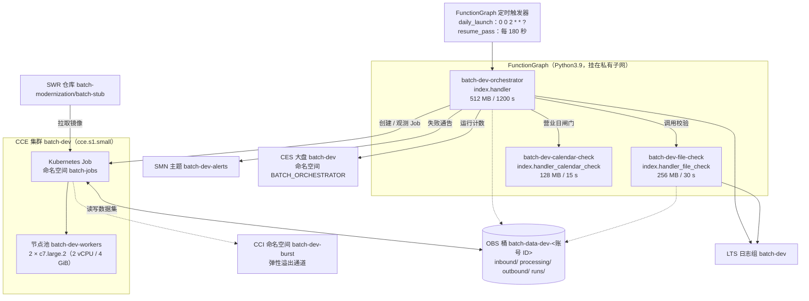

# 基于 FunctionGraph 与 CCE 的大型机批处理现代化编排实践

[](LICENSE)
[](https://www.huaweicloud.com)

> 本仓库是可在华为云复现的云原生最佳实践样例。中文版为准，英文版本见 [README.en.md](README.en.md)。

---

## 简介

企业里仍有大量以「作业链」形态运行的日终批处理：一支作业把落地文件规范化，两支作业并行消费它的产物，最后一支作业把两条分支的结果合并出账。这类负载要现代化，难点不在单支作业本身，而在**编排**：谁在等谁、今天该不该跑、某一步的输入文件到没到、一步失败后整条链如何收尾、一次执行跨越数小时而函数单次调用只有几分钟。

本实践给出一个可部署的完整答案：

- **FunctionGraph** 承载编排层与校验层，一共三个函数。编排函数用「一次调用 = 一趟推进」的方式驱动整条作业链，状态落盘到 OBS 的检查点对象，因此长时间运行与函数超时之间不再冲突。
- **CCE（云容器引擎）** 承载真正的批处理容器，以 Kubernetes Job 形式一支一支拉起；超出节点池容量的运行由 **CCI（云容器实例）** 命名空间吸收。
- **OBS** 既是数据湖（落地文件、中间数据集、结果、运行检查点、函数代码包），也是编排层与容器之间唯一的共享契约。
- **LTS / SMN / CES** 分别承担日志、失败通告与运行观测。

**解决的问题**：把「调度器 + 文件监听 + 人工盯夜批」这套隐性逻辑，显式地写成可版本化、可回放、可回归的函数代码与声明式基础设施。

**适用于谁**：需要把日终批处理搬上华为云、或希望用 Serverless 编排层托管容器作业链的平台工程师、SRE 与批处理负责人。

**作业链本身**：`JOB1`（规范化落地文件）→ `JOB2A`（手续费计算）与 `JOB2B`（返利计算）并行 → `JOB3`（合并出账）。四步的依赖关系以数据形式写在 `src/functions/orchestrator/plan.py`，改链不需要改编排逻辑。

---

## 目录

- [架构图](#架构图)
- [方案亮点](#方案亮点)
- [涉及云服务](#涉及云服务)
- [前置条件](#前置条件)
- [快速开始](#快速开始)
- [分步部署](#分步部署)
- [使用方法与验证](#使用方法与验证)
- [清理资源](#清理资源)
- [详细说明](#详细说明)
- [常见问题与故障排除](#常见问题与故障排除)
- [许可证](#许可证)
- [联系方式与维护者](#联系方式与维护者)

**目录结构**

```text
.
├── docs/                    架构说明与部署指导
├── infra/                   Terraform 根模块（huaweicloud Provider）
├── src/                     FunctionGraph 函数、批处理容器与 Kubernetes 清单
├── scripts/                 函数代码包构建脚本
├── README.md                本文件
└── LICENSE                  MIT No Attribution
```

---

## 架构图



**文字说明**

1. **入口只有两个定时触发器**。`daily_launch` 是六段 cron（秒 分 时 日 月 周），默认 `0 0 2 * * ?`，携带 `{"action":"start_run"}`；`resume_pass` 是周期触发，间隔取 `resume_interval_seconds`（默认 180 秒），携带 `{"action":"resume_runs"}`。前者开启当天运行，后者把在途运行往前推。
2. **编排函数不执行作业，只驱动作业**。它调用两个校验函数做判定，向集群 API 创建 Job，轮询 Job 直到容器回报退出码，再按退出码决定放行还是收敛。四步链被切成多趟调用完成，每趟都在自身时间预算内结束。
3. **状态全部在 OBS**。每次运行对应一个 `runs/<run-id>.json` 检查点对象，记录每一步的阶段、作业名、尝试次数与失败原因。函数超时、重启或重新部署都不会丢进度。
4. **数据面只有 OBS 一个交点**。容器读 `inbound/transactions/`，写 `processing/<步>/output/` 与 `outbound/`；编排层用同一套前缀判定输入是否就绪，因此「文件到没到」这个问题两边给出同一个答案。
5. **网络全程私有**。整套栈落在一对跨可用区的私有子网里，没有 NAT 网关、数据面也没有弹性公网 IP；OBS、SMN、CES 等区域服务通过内部服务网络段 `100.125.0.0/16` 以 443 端口访问，安全组只放行这一条路径。

---

## 方案亮点

1. **把「长时间批处理」和「函数执行时长上限」解耦**。一趟编排调用的预算由 `stage_budget_seconds`（默认 900 秒）控制，预算耗尽就把运行留在检查点上，交给下一趟周期触发继续。函数超时取 `stage_budget_seconds + 300`，即 1200 秒，留出收尾余量。
2. **营业日闸门与输入闸门都是独立函数**。`calendar_check` 判定当天是否处理日（周末恒为不处理日，额外日期从 OBS 的 `calendars/non-processing-days.json` 读取；该对象不存在时只按周末规则判定，这是全新部署的正常状态，不算故障）。`file_check` 判定某一步的输入是否齐备且足够新鲜，新鲜度窗口取 `max_input_age_days`（默认 2 个 UTC 日历天）。
3. **失败绝不静默吸收**。容器退出码非零、校验函数够不着、集群调用持续被拒、Job 不再回报，都会落成带原因的失败步骤，并按 `VERDICT_PRIORITY` 挑出最能说明问题的那一个；真失败不会被记成「前序步骤的输入文件没到」。平台侧原因（`DeadlineExceeded`、`PodEvicted`）走重试而非直接判死。
4. **回归运行与生产运行物理隔离**。`run_regression` 动作只要给出运行标识，整条链的读写前缀就整体挪到 `runs/<run-id>/` 之下，且不套营业日闸门、可任意顺序取模块；测试运行不可能读到、更不可能覆盖生产数据集。
5. **声明式并发控制**。节点池固定 2 个节点，作业请求 `500m` CPU、上限 1 核，因此一台节点刚好放两个作业槽位；并行分支的调度由 `Plan.slots_free()` 与在途作业数共同约束，回归并发取 `regression_max_concurrency`（默认 3）。
6. **凭据不下发到代码里**。函数侧通过 FunctionGraph 委托（agency）取临时凭据，集群侧通过 CCE 委托拉镜像与挂载 OBS；OBS 桶策略以委托名为主体授权，桶级阻止公共访问四个开关全开，并额外用策略拒绝非 TLS 请求。
7. **代码包可复现构建**。`scripts/package_functions.py` 固定条目顺序、时间戳与权限位，同一份源码重复构建得到字节一致的包；构建前会编译每个源文件、校验处理器函数确实定义、校验包根目录存在 `index.py`，并**把产物路径与 `infra/functions.tf` 的 `source` 声明逐字符比对**，不一致直接构建失败。

---

## 涉及云服务

| 云服务 | 在本实践中的角色 | 本仓库创建的资源 |
|-|-|-|
| **FunctionGraph（FGS）** | 编排层与两个校验层的运行时；定时触发器提供调度 | 函数 `batch-dev-orchestrator`、`batch-dev-file-check`、`batch-dev-calendar-check`；触发器 `daily_launch`（Cron）、`resume_pass`（Period） |
| **云容器引擎 CCE** | 批处理容器所在的私有集群 | 集群 `batch-dev`（`cce.s1.small`，`overlay_l2` 容器网络，时区 `UTC+08:00`）；节点池 `batch-dev-workers` |
| **云容器实例 CCI** | 超出节点池容量时的弹性通道 | 命名空间 `batch-dev-burst`（`general-computing`）、每 Pod 网络 `batch-dev-burst-network` 与子网 `batch-dev-pod-subnet` |
| **对象存储服务 OBS** | 数据湖、检查点存储、函数代码包存储 | 桶 `batch-data-<环境>-<账号 ID>`（版本化、AES256 落盘加密、private）、阻止公共访问、桶策略、两条生命周期规则、两个代码包对象 |
| **云日志服务 LTS** | 三个函数的运行日志落点 | 日志组 `batch-dev`；日志流 `batch-dev-orchestrator`、`batch-dev-validation`；保留天数取 `log_retention_days`（默认 30） |
| **消息通知服务 SMN** | 运行失败通告与告警通知通道 | 主题 `batch-dev-alerts`；`notification_email` 非空时创建 email 协议订阅 |
| **云监控服务 CES** | 自定义指标命名空间与运维大盘 | 大盘 `batch-dev`；两个组件 `Failed runs`（柱状）、`Run duration in seconds`（折线）；`enable_ces_alarms` 打开时另建两条告警规则 |
| **容器镜像服务 SWR** | 批处理作业镜像的私有仓库 | 组织 `batch-modernization`；私有仓库 `batch-stub` |
| **虚拟私有云 VPC / 子网 / 安全组** | 整套栈的私有网络边界 | VPC `batch-dev-vpc`（`10.20.0.0/16`）；子网 `batch-dev-subnet-a`（cn-north-4a）、`batch-dev-subnet-b`（cn-north-4b）；安全组 `batch-dev-jobs-sg` 及 7 条规则 |
| **弹性公网 IP（可选）** | 仅用于从 VPC 外访问集群 API Server | `enable_api_server_public_access` 为 `true` 时创建 `batch-dev-api-eip` 与带宽 `batch-dev-api-bandwidth`（默认 5 Mbit/s）；默认不创建 |
| **统一身份认证 IAM 委托** | 让云服务以临时凭据访问数据面 | 委托 `batch-dev-functions-agency`（委托服务 `op_svc_cff`）、`batch-dev-cluster-agency`（委托域 `op_svc_cce`） |

**关于弹性通道与公网入口**：`enable_api_server_public_access` 默认为 `false`，交付拓扑的数据面不经过公网。`enable_ces_alarms` 默认为 `false`——自定义指标命名空间上的告警规则需要在云监控侧按同样的指标、维度与阈值创建，因此告警规则属于显式选装项，不随默认部署落地；大盘与自定义指标上报（`enable_custom_metrics` 默认 `true`）不受此影响。

---

## 前置条件

**账号与权限**

- 一个华为云账号，已开通 FunctionGraph、CCE、CCI、OBS、LTS、SMN、CES、SWR、VPC、IAM。
- 操作用户具备创建上述服务资源的权限。IAM 委托由栈自动创建，无需手工建：
  - `batch-dev-functions-agency` → 委托服务 `op_svc_cff`；账号级角色 `OBS Administrator`；`cn-north-4` 项目级角色 `SMN FullAccess`、`CES FullAccess`，可通过 `agency_extra_roles` 追加。
  - `batch-dev-cluster-agency` → 委托域 `op_svc_cce`；`cn-north-4` 项目级角色 `OBS OperateAccess`、`SWR Admin`、`CCE Admin`。
- 在华为云「我的凭证」页面获取 Access Key ID 与 Secret Access Key，填入部署脚本；不要把凭据写入代码或提交到仓库。

**版本与工具**

| 工具 | 要求 |
|-|-|
| Terraform | `>= 1.5.0`（`infra/versions.tf`） |
| huaweicloud Provider | `1.96.1`（`infra/versions.tf`） |
| Python（构建与函数运行时） | 本地 3.9 及以上；函数 runtime 固定为 `Python3.9` |
| kubectl | 与集群版本匹配的发行版，用于应用 `src/manifests/` |
| Docker（或等效容器构建工具） | 构建并推送批处理作业镜像 |

**区域与可用区约束**

- 区域固定为 `cn-north-4`，写在 `infra/locals.tf`，所有端点、可用区与时区都按该区域表达。
- 子网分别落在 `cn-north-4a`（`subnet_a_az`）与 `cn-north-4b`（`subnet_b_az`）；CCI 每 Pod 网络在 `cn-north-4b`。
- 集群时区 `UTC+08:00`；营业日判定所用 IANA 时区取 `schedule_timezone`（默认 `Asia/Shanghai`）。
- 区域端点后缀取 `cloud`（默认 `myhuaweicloud.com`）。

**部署参数**（完整清单见 `infra/variables.tf`，样例见 `infra/terraform.tfvars.example`）

| 变量 | 类型 | 默认值 | 说明 |
|-|-|-|-|
| `access_key` / `secret_key` | string | `""` | 留空则从环境读取 `HW_ACCESS_KEY` / `HW_SECRET_KEY` |
| `environment` | string | `dev` | 进入资源名与桶名；正则 `^[a-z][a-z0-9-]{1,15}$` |
| `name_prefix` | string | `batch` | 所有资源名的公共前缀，同时决定指标命名空间 |
| `notification_email` | string | `""` | 留空则不建订阅，主题仍然创建 |
| `agency_extra_roles` | list(string) | `[]` | 追加到函数委托的项目级角色 |
| `vpc_cidr` / `subnet_a_cidr` / `subnet_b_cidr` | string | `10.20.0.0/16` / `10.20.1.0/24` / `10.20.2.0/24` | 私有网络 |
| `container_network_cidr` / `service_network_cidr` | string | `172.16.0.0/16` / `10.254.0.0/16` | Pod 网络与 ClusterIP 段 |
| `cluster_spec` | string | `cce.s1.small` | 集群规格，`cce.s1.small` 支持至 50 个节点 |
| `node_flavor` | string | `c7.large.2` | 工作节点规格：2 vCPU / 4 GiB，x86_64 |
| `node_count` | number | `2` | 节点池固定节点数，对应两个并发作业槽位 |
| `node_os` | string | `Huawei Cloud EulerOS 2.0` | 节点操作系统 |
| `node_root_volume_size` / `node_root_volume_type` | number / string | `40` / `SAS` | 系统盘容量（GiB）与磁盘类型 |
| `node_data_volume_size` / `node_data_volume_type` | number / string | `100` / `SAS` | 数据盘容量（GiB）与磁盘类型，容纳镜像缓存 |
| `node_pool_key_pair` / `node_password` | string | `""` / `""` | **二者必须给一个**（`cce.tf` 里的 `precondition` 会拦） |
| `enable_api_server_public_access` | bool | `false` | 是否给 API Server 挂弹性公网 IP |
| `api_server_bandwidth_mbitps` | number | `5` | 仅在开启公网入口时使用 |
| `cci_enabled` | bool | `true` | 是否创建弹性溢出通道 |
| `cci_namespace_type` | string | `general-computing` | 命名空间类型 |
| `cci_pod_network_cidr` | string | `10.20.3.0/24` | 每 Pod 网络子网 |
| `cci_warmup_pool_size` | number | `10` | 预分配地址数，取值 1–500 |
| `swr_organization` / `swr_repository` / `swr_image_tag` | string | `batch-modernization` / `batch-stub` / `1.0.0` | 作业镜像地址三段 |
| `lifecycle_transition_days` | number | `30` | 中间数据集转入低频存储类的天数，同时是旧代码包版本清理天数 |
| `log_retention_days` | number | `30` | 日志组与日志流保留天数 |
| `schedule_timezone` | string | `Asia/Shanghai` | 营业日判定时区 |
| `daily_cron` | string | `0 0 2 * * ?` | 六段 cron：秒 分 时 日 月 周 |
| `resume_interval_seconds` | number | `180` | 检查点续跑触发间隔（秒） |
| `max_input_age_days` | number | `2` | 落地文件可接受的最大龄期（UTC 日历天） |
| `stage_budget_seconds` | number | `900` | 单趟编排调用的时间预算 |
| `job_deadline_seconds` | number | `7200` | 单个容器的硬截止，写进 Job 的 `activeDeadlineSeconds` |
| `job_cpu_request` / `job_memory_request` | string | `500m` / `1Gi` | 容器请求 |
| `job_cpu_limit` / `job_memory_limit` | string | `1` / `2Gi` | 容器上限 |
| `regression_max_concurrency` | number | `3` | 回归运行的并行模块数 |
| `job_namespace` | string | `batch-jobs` | 作业所在命名空间 |
| `k8s_api_server` / `k8s_ca_cert` / `k8s_service_account_token` | string | `""` | **首次 apply 留空**，建出集群后回填 |
| `enable_ces_alarms` | bool | `false` | 自定义指标告警规则为选装项 |
| `enable_custom_metrics` | bool | `true` | 是否由编排层上报运行计数 |
| `duration_alarm_threshold_seconds` | number | `1800` | 时长告警阈值 |
| `failure_alarm_suppression_minutes` | number | `15` | 取值限 `0/5/10/15/30/60/180/360/720/1440` |

---

## 快速开始

> 本实践是**两次 apply** 的部署：第一次建出集群，中间用 kubectl 建命名空间、RBAC 与配置项，再取回三项集群访问参数，第二次 apply 把它们写进编排函数。不存在「一条命令装完」的路径，请按下面的顺序执行。

**开始前必须完成的手工前置动作：构建并推送作业镜像。**
`infra/locals.tf` 用 `huaweicloud_swr_organization.main.login_server` 拼出 `batch_image`，Job 的 `image` 字段直接引用它；`infra/swr.tf` 只创建 SWR 组织与私有仓库，**不构建、不推送镜像**。若仓库里没有对应标签的镜像，作业会停在 `ImagePullBackOff`。

```bash
# 0) 凭据（在华为云「我的凭证」页面获取，不要提交到仓库）
export HW_ACCESS_KEY=<HW_ACCESS_KEY>
export HW_SECRET_KEY=<HW_SECRET_KEY>

# 1) 离线校验（不触碰云端）
python -m pytest src/functions -q
python scripts/package_functions.py
cd infra && terraform validate && cd ..

# 2) 构建并推送作业镜像到 SWR（<registry host> 取自 terraform output image_registry_host）
docker login <registry host>
docker build -t <registry host>/batch-modernization/batch-stub:1.0.0 src/job
docker push <registry host>/batch-modernization/batch-stub:1.0.0

# 3) 准备部署参数
cd infra
cp terraform.tfvars.example terraform.tfvars      # 然后填入节点登录方式等必填项
terraform init
terraform apply                                    # 第一次：建出集群，k8s_* 三项留空

# 4) 集群内对象（30-batch-job-template.yaml 是模板，不要 apply）
kubectl apply -f ../src/manifests/00-namespace.yaml \
              -f ../src/manifests/10-rbac.yaml \
              -f ../src/manifests/20-batch-config-configmap.yaml
kubectl -n batch-jobs create secret generic batch-obs-credentials \
  --from-literal=HW_ACCESS_KEY=<HW_ACCESS_KEY> \
  --from-literal=HW_SECRET_KEY=<HW_SECRET_KEY>

# 5) 取回三项集群访问参数并回填 terraform.tfvars
../src/job/export_k8s_access.sh

# 6) 第二次 apply
terraform apply
terraform output next_step_inputs
```

---

## 分步部署

### 步骤 1　离线校验

三条命令都不访问云端，应在申请资源之前跑通。

```bash
python -m pytest src/functions -q
```

预期输出（末行）：

```text
292 passed in 0.64s
```

```bash
python scripts/package_functions.py
```

预期输出：

```text
函数代码包构建完成：
  orchestrator  infra/.build/batch-orchestrator.zip      20 个条目   42.4 KiB  sha256 fa81bffe1468
  checks        infra/.build/batch-checks.zip            20 个条目   42.4 KiB  sha256 52b683323878
根目录入口：index.py（处理器名见 infra/functions.tf）
```

两个包由 `infra/functions.tf` 经 `local.build_dir`（`infra/locals.tf` 中定义为 `${path.module}/.build`）作为 `huaweicloud_obs_bucket_object` 的 `source` 读取，先上传到 OBS 再以 `code_type = "obs"` 交给函数。只构建其中一个：`python scripts/package_functions.py --only orchestrator`。

```bash
cd infra
terraform validate
```

`terraform validate` 只做本地配置校验，需要 Provider 插件已在本地（先执行 `terraform init`，或指向本地插件缓存）。

预期输出：

```text
Success! The configuration is valid, but there were some validation warnings as shown above.
```

### 步骤 2　构建并推送作业镜像（手工前置）

镜像上下文在 `src/job/`：`Dockerfile` 基于 `python:3.11-slim`，以 UID/GID `10001` 非特权运行，入口 `entrypoint.sh` 把 Job 传入的步名转成 `python3 -m batch_job <STEP>`，容器退出状态码就是批处理程序的退出码，编排层据此路由下一步。

```bash
docker build -t <registry host>/batch-modernization/batch-stub:1.0.0 src/job
docker login -u <用户名> -p <SWR 访问密钥> <registry host>
docker push <registry host>/batch-modernization/batch-stub:1.0.0
```

镜像地址的三段分别由 `swr_organization`、`swr_repository`、`swr_image_tag` 决定，改动必须与 `terraform.tfvars` 保持一致，否则 Job 拉到的是另一个标签。`<registry host>` 在第一次 apply 后用 `terraform output image_registry_host` 取。

### 步骤 3　准备 `terraform.tfvars`

```bash
cd infra
cp terraform.tfvars.example terraform.tfvars
```

`terraform.tfvars` 已被根 `.gitignore` 与 `infra/.gitignore` 忽略。需要确认三件事：

1. **给出节点登录方式**：`node_pool_key_pair`（已导入密钥对的名称，不是公钥字符串）或 `node_password` 二选一。也可以用 `export TF_VAR_node_password="<节点登录密码>"` 走环境。两者都为空时，`huaweicloud_cce_node_pool.workers` 的 `precondition` 会在 plan 阶段报 `Set node_pool_key_pair or node_password: worker nodes require one of the two.`
2. **确认 `k8s_api_server` / `k8s_ca_cert` / `k8s_service_account_token` 三项为空**，第一次 apply 不填。
3. 需要收到运行失败通告时，把 `notification_email` 填成运维邮箱（例如 `notification_email = "<EMAIL>"`）；留空则不创建订阅，SMN 主题仍然创建，告警仍可投递进该主题。

### 步骤 4　第一次 apply：建出集群

```bash
terraform init
terraform apply
```

预期输出末尾为 Terraform 的标准摘要 `Plan: <N> to add, 0 to change, 0 to destroy.`，确认后输入 `yes`，结束于 `Apply complete! Resources: <N> added, 0 changed, 0 destroyed.`。此时集群、节点池、VPC、OBS 桶、SWR 仓库、函数与触发器均已创建；函数的 `K8S_API_SERVER` 等仍为空字符串。

> 建集群与节点池需要等待若干分钟。第一次 apply 期间若编排函数被触发，它会在启动阶段报「`K8S_API_SERVER, K8S_SA_TOKEN` was never named to this function」，属预期，回填后消失。

### 步骤 5　配置 kubectl 并应用集群内对象

在华为云 CCE 控制台的集群「连接信息」下载 kubeconfig，把 `KUBECONFIG` 指向它（或合并进 `~/.kube/config`）。

```bash
kubectl apply -f ../src/manifests/00-namespace.yaml
kubectl apply -f ../src/manifests/10-rbac.yaml
kubectl apply -f ../src/manifests/20-batch-config-configmap.yaml
```

预期输出：

```text
namespace/batch-jobs created
serviceaccount/batch-orchestrator created
serviceaccount/batch-job-runner created
role.rbac.authorization.k8s.io/batch-orchestrator created
rolebinding.rbac.authorization.k8s.io/batch-orchestrator created
secret/batch-orchestrator-token created
configmap/batch-config created
```

**`30-batch-job-template.yaml` 是逐次运行的模板，永远不要直接 apply。** 其中的 `__JOB_NAME__`、`__NAMESPACE__`、`__RUN_ID__`、`__TASK__`、`__IMAGE__`、`__PREFIX__`、`__DEADLINE__`、`__TTL__`、`__CPU_REQUEST__` 等占位符由编排层在创建 Job 时逐字段填入（`src/functions/orchestrator/index.py` 的 `Engine.job_body()` 产出的就是这个结构），手改或直接提交这份文件不会得到可运行的作业。

`20-batch-config-configmap.yaml` 里 `OBS_BUCKET` 的初值是 `REPLACE_ME`，必须换成第一次 apply 的真实桶名，否则容器在启动自检阶段就会报：

```text
OBS_BUCKET is empty: the batch-config map has no bucket
```

```bash
terraform output data_bucket        # 记下真实桶名，填进 ConfigMap
kubectl apply -f ../src/manifests/20-batch-config-configmap.yaml
```

ConfigMap 必须覆盖 `OBS_BUCKET`、`OBS_ENDPOINT`、`OBS_REGION`、`INBOUND_PREFIX`、`PROCESSING_PREFIX`、`OUTBOUND_PREFIX`、`LOG_LEVEL` 七项（清单见 `src/job/batch_job/settings.py` 的 `CONFIG_MAP_KEYS`）。

### 步骤 6　创建凭据对象供容器访问数据湖

作业 Pod 通过可选的 `batch-obs-credentials` 拿到本次运行的 OBS 访问密钥；该 Secret 标记为 `optional: true`，因此不存在时 Pod 仍能启动，容器会在自检里报出缺失：

```text
no access key pair: create the batch-obs-credentials secret with the literals HW_ACCESS_KEY and HW_SECRET_KEY
```

```bash
kubectl -n batch-jobs create secret generic batch-obs-credentials \
  --from-literal=HW_ACCESS_KEY=<HW_ACCESS_KEY> \
  --from-literal=HW_SECRET_KEY=<HW_SECRET_KEY>
```

预期输出：`secret/batch-obs-credentials created`

### 步骤 7　取回集群访问参数并回填

```bash
../src/job/export_k8s_access.sh
```

脚本从当前 kubeconfig 读 API Server 地址，读取 `batch-jobs/batch-orchestrator-token` 这个 Secret 的 `data.token` 与 `data.ca.crt`（未签发时每 2 秒重试，最长等 60 秒），解码 JWT 并校验主体是否为 `system:serviceaccount:batch-jobs:batch-orchestrator`，然后打印可直接粘贴的三行：

```text
k8s_api_server                = "https://<内网地址>:5443"
k8s_service_account_token     = "<JWT>"
k8s_ca_cert = <<-EOT
-----BEGIN CERTIFICATE-----
...
-----END CERTIFICATE-----
EOT
```

把这三行写入 `terraform.tfvars`（`k8s_service_account_token` 是长期有效令牌，不要提交、不要粘贴进工单或聊天工具）。可覆盖的参数：`--namespace`、`--secret`、`--service-account`、`--api-server`、`--wait`。

### 步骤 8　第二次 apply

```bash
terraform apply
```

预期把 `K8S_API_SERVER`、`K8S_NAMESPACE`、`K8S_CA_CERT`、`K8S_SA_TOKEN` 写进编排函数的运行配置，输出 `Apply complete! Resources: 0 added, <N> changed, 0 destroyed.`

```bash
terraform output next_step_inputs
```

预期输出：

```text
next_step_inputs = "k8s_api_server                = output.cluster_api_server
k8s_ca_cert                   = export_k8s_access.sh -> CA
k8s_service_account_token     = export_k8s_access.sh -> token"
```

---

## 使用方法与验证

### 最简示例：手动开启一次运行

FunctionGraph 控制台打开 `batch-dev-orchestrator` → 函数测试，输入：

```json
{
  "action": "start_run",
  "runDate": "2026-11-16",
  "budgetSeconds": 120
}
```

预期返回（字段名与 `Engine.handle()` 逐字一致）：

```json
{
  "action": "start_run",
  "kind": "manual",
  "passBudgetSeconds": 120,
  "passElapsedSeconds": 12.4,
  "budgetSpent": false,
  "runs": [
    {
      "runId": "batch-2026-11-16",
      "kind": "manual",
      "runDate": "2026-11-16",
      "status": "FAILED",
      "errorType": "INPUT_FILES_MISSING",
      "message": "4 step(s) never started: JOB1 (INPUT_FILES_MISSING), JOB2A (INPUT_FILES_MISSING), JOB2B (INPUT_FILES_MISSING), JOB3 (INPUT_FILES_MISSING)",
      "phases": { "JOB1": "skipped", "JOB2A": "skipped", "JOB2B": "skipped", "JOB3": "skipped" },
      "unfinished": [],
      "checkpoint": "runs/batch-2026-11-16.json",
      "notification": { "published": "<主题 URN>" },
      "counters": {}
    }
  ]
}
```

字段名与 `Engine.handle()` / `Engine._report_of()` 逐字一致。`notification` 承载失败通告的结果：成功时为 `{"published": "<主题 URN>"}`，被服务侧拒时改为 `{"rejected": "<原因>"}`，未配置主题时为 `{"skipped": "no notification topic configured"}`。`counters` 承载云监控批量上报接口的返回体；关闭上报（`enable_custom_metrics = false`）或未取到命名空间时为 `{}`。

全新部署没有落地文件，因此这一步就应当给出 `INPUT_FILES_MISSING`；`runId` 由日期构成，同一天再点一次会续跑已开启的运行而不是另开一个。

**准备好落地文件（模式 `^txns\.\d{8}\.csv$`）**：

```bash
terraform output data_bucket
terraform output inbound_prefix
obsutil cp txns.20261116.csv obs://<桶名>/inbound/transactions/txns.20261116.csv
```

再点一次上面的事件，`JOB1` 会变成 `running`，`phases` 里出现作业名 `job-job1-batch-2026-11-16`。用 kubectl 观察：

```bash
kubectl -n batch-jobs get jobs -l batch.job/run-id=batch-2026-11-16
kubectl -n batch-jobs logs -l batch.job/run-id=batch-2026-11-16 --tail=40
```

### 单独问两个校验函数

`batch-dev-file-check`，输入 `{"jobName": "JOB1"}`，预期：

```json
{
  "step": "JOB1", "jobName": "JOB1", "allFilesPresent": true, "errorType": null,
  "bucket": "<桶名>", "prefix": "(production)",
  "filesChecked": 1, "missingCount": 0, "maxAgeDays": 2,
  "message": "Every input of JOB1 is present."
}
```

步名可用 `JOB1`／`job1`／`Check_JOB1_Input_Files`；给出未知名字时返回 `errorType: "INPUT_FILES_INVALID"` 与 `knownSteps`。带上 `"runId": "night-7"` 则判定范围挪到 `runs/night-7/` 之下。

`batch-dev-calendar-check`，输入 `{"runDate": "2026-11-16"}`（周一），预期：

```json
{
  "isBusinessDay": true, "date": "2026-11-16", "reason": "business day",
  "timezone": "Asia/Shanghai", "calendar": "no calendar object"
}
```

输入 `{"runDate": "2026-11-15"}`（周日）则 `isBusinessDay` 为 `false`、`reason` 为 `"weekend"`。若已上传 `calendars/non-processing-days.json`，`calendar` 字段变为 `"<N> non-processing date(s)"`，命中日期时 `reason` 为 `"non-processing date"`。

### 隔离回归运行

```json
{ "action": "run_regression", "runId": "night-7", "modules": ["JOB1", "JOB3"] }
```

回归运行不套营业日闸门、模块可任意顺序，读写全部落在 `runs/night-7/` 前缀内。故意不给 `modules` 会抛错并列出已知模块；给出拼错的名字，返回体里出现 `rejected` 字段而不是静默成功。并发上限取 `regression_max_concurrency`。

### 验证清单

| 验证项 | 命令 / 位置 | 预期 |
|-|-|-|
| 各模块与整流程用例 | `python -m pytest src/functions -q` | `292 passed` |
| 代码包与部署声明对齐 | `python scripts/package_functions.py` | 两个 zip，产物路径与 `infra/functions.tf` 逐字符一致 |
| 配置合法性 | `terraform validate` | `Success!` |
| 数据桶与端点 | `terraform output data_bucket`、`terraform output object_storage_endpoint` | 桶名 + `https://obs.cn-north-4.myhuaweicloud.com` |
| 三个函数 URN | `terraform output orchestrator_function_urn` 等三个输出 | `urn:fgs:...` |
| 调度 | `terraform output daily_schedule`、`terraform output resume_interval_seconds` | `0 0 2 * * ?` 与 `180` |
| 镜像地址 | `terraform output batch_image`、`terraform output image_registry_host` | `<login_server>/batch-modernization/batch-stub:1.0.0` |
| 弹性通道 | `terraform output burst_namespace`、`terraform output burst_network_id` | `batch-dev-burst` 与网络 ID；`cci_enabled = false` 时为空串 |
| 指标命名空间 | `terraform output metric_namespace` | `BATCH_ORCHESTRATOR`（只含字母、数字、下划线） |
| 触发器状态 | FunctionGraph 控制台 | `daily_launch`、`resume_pass` 均为 `ACTIVE` |
| 函数日志 | LTS 日志组 `batch-dev` | 日志流 `batch-dev-orchestrator` 出现 `pass opened: action=...`；`batch-dev-validation` 出现 `file check answered: ...` |
| 作业与 Pod | `kubectl -n batch-jobs get jobs` | Job 名形如 `job-<步小写>-<run-id>`，标签含 `batch.job/run-id` |
| 检查点 | `obsutil ls obs://<桶名>/runs/` | 每次运行一个 `<run-id>.json` |
| 运行观测 | CES 大盘 `batch-dev` | 组件 `Failed runs`、`Run duration in seconds` 有数据点 |
| 失败通告 | SMN 主题 `batch-dev-alerts`（订阅邮箱） | 邮件主题 `<workflow>: run <runId> failed (<errorType>)` |

> **部署完成后请按本节步骤在真实环境自行验证**：确认作业链能跑通、检查点能落 OBS、失败通告能到达、大盘有数据点，功能可用后方可视为交付完成。

---

## 清理资源

```bash
cd infra
terraform destroy
```

销毁前建议先按 [使用方法与验证](#使用方法与验证) 确认桶内不再有需要留存的产物。集群创建时带 `delete_all = "true"`，节点池随集群一并释放；OBS 桶带 `force_destroy = true`，**桶内对象（含全部版本）会被一并删除**，请先导出需要保留的结果数据集与检查点。

及时释放资源，避免残留。`src/manifests/` 建立的命名空间与 RBAC 对象随集群销毁而消失；`batch-obs-credentials` 里的访问密钥建议在控制台一侧另行吊销。`infra/.build/` 下的两个 zip 是构建产物，可随时用 `python scripts/package_functions.py` 重建。

---

## 详细说明

- [docs/architecture.md](docs/architecture.md)　架构组成、一趟调用的数据流、关键设计取舍与失败语义。
- [docs/deployment-guide.md](docs/deployment-guide.md)　从零到可验证部署的完整命令与逐条预期输出。

**作业链拓扑**（`src/functions/orchestrator/plan.py`）

| 步 | 依赖 | 产出给 | 读取的输入 |
|-|-|-|-|
| `JOB1` | — | `JOB2A`、`JOB2B` | `inbound/transactions/` 下匹配 `^txns\.\d{8}\.csv$`，且要求新鲜 |
| `JOB2A` | `JOB1` | `JOB3` | `processing/JOB1/output/normalized.csv` |
| `JOB2B` | `JOB1` | `JOB3` | `processing/JOB1/output/normalized.csv` |
| `JOB3` | `JOB2A`、`JOB2B` | — | `processing/JOB2A/output/fees.csv` 与 `processing/JOB2B/output/rebates.csv` |

只有 `JOB1` 的输入受 `max_input_age_days` 约束——中间数据集是本轮自己刚写的，套龄期规则只会在列举慢时把整条链卡住。

**运行状态机**（`src/functions/orchestrator/state.py`）
步级阶段：`pending` / `running` / `waiting for retry` / `succeeded` / `failed` / `skipped`。
运行级状态：`RUNNING` / `SUCCEEDED` / `FAILED` / `SKIPPED`。收敛规则：有失败步则 `FAILED`；没有失败但有步从未启动也记 `FAILED`；全部成功记 `SUCCEEDED`；非处理日记 `SKIPPED` 且不上报任何计数，因此不会误触告警。

**退出码路由**
容器成功回报退出码 0 → 放行后续步；退出码非零 → `BATCH_JOB_FAILED` 并附平台原因与容器日志尾部（最多 40 行、2000 字符）；无退出码 → `CLUSTER_CALL_FAILED`；Job 已消失 → `JOB_NOT_FOUND`；`DeadlineExceeded`／`DeadlineExceededSilent`／`PodEvicted` 视为平台侧原因，按重试策略延后一次尝试，超过 `RETRY_MAX_ATTEMPTS`（2）才判死。

**上报的三个指标**（命名空间 `BATCH_ORCHESTRATOR`，维度 `run_environment`）
`batch_run_success`、`batch_run_failed`、`batch_run_duration`。大盘展示后两条序列；`enable_ces_alarms` 打开时另建 `failed-runs`（`sum` ≥ 1，级别 2，抑制窗口取 `failure_alarm_suppression_minutes`）与 `run-duration`（`max` > `duration_alarm_threshold_seconds`，级别 3，抑制 900 秒）两条规则。

**运行期让权**：`huaweicloud_fgs_trigger.*` 忽略 `timer`/`status`（活动中的定时触发无法原地更新，改调度需重建触发器）；`cci_namespace.warmup_pool_size` 与 `fgs_function.code_url` 同样忽略运行期改写。

---

## 常见问题与故障排除

**`Set node_pool_key_pair or node_password: worker nodes require one of the two.`**
plan 阶段的 `precondition`。给一个密钥对名称或 `export TF_VAR_node_password="<节点登录密码>"`。`node_pool_key_pair` 取的是已导入密钥对的名称，填公钥字符串不生效。

**作业一直 `ImagePullBackOff`**
镜像没有推送到 `swr_organization`/`swr_repository`/`swr_image_tag` 拼出的地址。`terraform output batch_image` 与 `docker push` 的目标逐段核对；节点侧靠 `batch-dev-cluster-agency` 的 `SWR Admin` 拉镜像，不需要 imagePullSecret。

**编排函数报 `the batch containers cannot be started: ... was never named to this function`**
`k8s_api_server` / `k8s_service_account_token` 仍是空——步骤 7、8 没做完。回填后重新 apply。

**`export_k8s_access.sh` 报「等待 60s 后仍未取到令牌」**
`10-rbac.yaml` 没应用，或 Secret 的 `kubernetes.io/service-account.name` 注解指向的不是 `batch-orchestrator`。用 `--namespace` / `--secret` / `--service-account` 对齐清单里的名字，或先重跑 `kubectl apply -f ../src/manifests/10-rbac.yaml`。令牌轮换的方式就是删除并重建该 Secret，然后重跑部署。

**`找不到 kubectl` / `无法从当前 kubeconfig 读到集群地址`**
安装 kubectl 并把 `KUBECONFIG` 指向控制台下载的 kubeconfig。集群在本部署拓扑下没有公网入口（`enable_api_server_public_access = false`），kubectl 必须从 VPC 内的主机运行；确需从 VPC 外访问时，把该开关置 `true` 并重新 apply，`api_server_bandwidth_mbitps`（默认 5）只在开启时使用。

**容器报 `OBS_BUCKET is empty: the batch-config map has no bucket`**
ConfigMap 里的 `REPLACE_ME` 没换成真实桶名。

**容器报 `no access key pair: ...`**
`batch-obs-credentials` 这个凭据对象没建，或字面量名字写错（必须是 `HW_ACCESS_KEY`、`HW_SECRET_KEY`）。

**运行报 `CHECK_NOT_WIRED`**
`FILE_CHECK_URN` / `CALENDAR_CHECK_URN` 没进到函数运行配置。这两个值由栈自动写入编排函数，出现该错误通常是首次 apply 时两个校验函数尚未创建成功；重新 apply 即可。

**运行报 `CHECK_INVOCATION_FAILED` 或 `ANSWER_UNREADABLE`**
校验函数够不着，或回答里缺少路由所依据的字段（`allFilesPresent` / `isBusinessDay`）。这两种情况一律记失败而不是猜一个结论——猜错要么卡死健康链，要么放行破损链。

**OBS 请求被拒**
桶策略以委托名为主体授权：`domain/<账号 ID>:agency/batch-dev-functions-agency` 与 `.../batch-dev-cluster-agency`，动作限于 `GetObject`、`PutObject`、`DeleteObject`、`ListBucket`；桶级阻止公共访问四项全开，并有拒绝非 TLS 的策略语句。请确认客户端用 HTTPS 且经委托取临时凭据。

**告警规则创建失败**
`enable_ces_alarms` 默认 `false` 即为此：绑定自定义指标命名空间的告警规则需要在云监控侧创建。请在云监控控制台按 `metric_namespace`、维度 `run_environment = <环境>` 与阈值手工建同样两条规则，或先确认 `agency_extra_roles` 已含自定义指标写入所需的项目级角色。

**改 `daily_cron` 或 `resume_interval_seconds` 后调度没变**
触发器对 `timer` 与 `status` 设了 `ignore_changes`——活动中的定时触发无法原地更新。请在 FunctionGraph 控制台删除触发器后重新 apply。

**第二次 apply 想把 CCI 预热地址池拉回 10**
`cci_namespace.warmup_pool_size` 已 `ignore_changes`，出现该 diff 说明改动来自别处；预热池由平台按运行伸缩，`1`–`500` 只是初值范围。

---

## 许可证

本实践采用 MIT No Attribution 许可证发布，条款见 [LICENSE](LICENSE)。

## 联系方式与维护者

本实践由**公有云持续运营部**创建与维护。
