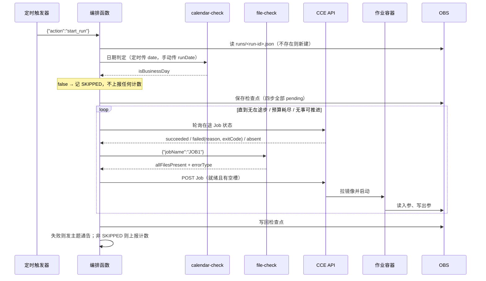

# 架构说明

本实践把「日终批处理作业链」拆成三层：**调度层**（FunctionGraph 定时触发器）、**编排与校验层**（三个 Python 函数）、**执行层**（CCE 集群里的 Kubernetes Job，容量不足时由 CCI 命名空间吸收）。三层之间没有 RPC 调用链，只有一个共享数据面——OBS 桶。

---

## 1. 组件清单

### 1.1 调度层

| 触发器 | 类型 | 调度取值 | 携带的动作 |
|-|-|-|-|
| `batch-dev-daily-launch` | `Cron` | `var.daily_cron`，默认 `0 0 2 * * ?`（秒 分 时 日 月 周） | `{"action":"start_run","user_event":"Daily batch launch"}` |
| `batch-dev-resume-pass` | `Period` | `var.resume_interval_seconds`，默认 `180`（纯秒数） | `{"action":"resume_runs","user_event":"Advance in flight runs"}` |

两者都挂在 `huaweicloud_fgs_function.orchestrator.urn` 上，`status = "ACTIVE"`，并对 `timer` 与 `status` 设了 `ignore_changes`——活动中的定时触发无法原地更新，这是平台约束，不是疏忽。

### 1.2 编排与校验层

三个函数都以 `code_type = "obs"` 从 OBS 取代码包，runtime 固定 `Python3.9`，都挂在私有子网 `subnet_a` 上，都写 LTS。

| 函数 | 处理器 | 内存 | 超时 | 并发实例上限 | 职责 |
|-|-|-|-|-|-|
| `batch-dev-orchestrator` | `index.handler` | 512 MB | `stage_budget_seconds + 300`（默认 1200 s） | `3` | 开启运行、驱动作业、轮询退出码、路由下一步、收敛并上报 |
| `batch-dev-file-check` | `index.handler_file_check` | 256 MB | 30 s | `2` | 某一步的输入是否齐备、落地数据是否足够新鲜 |
| `batch-dev-calendar-check` | `index.handler_calendar_check` | 128 MB | 15 s | `2` | 这次调度点是否落在处理日 |

两个校验函数共用 `batch-checks.zip` 这一个代码包，各自指向包内不同处理器名——这就是「一次判定一个函数、但两处共用一份实现」的落法。

编排层向函数写入的运行配置分三组（`infra/functions.tf`）：`common_env`（区域、环境、项目 ID、桶名、OBS 端点、日志级别）、`data_env`（四个前缀 + 日历对象 + 龄期窗口 + 时区），以及编排函数独有的 `orchestrator_env`（两个校验函数的 URN、三项集群访问参数、镜像地址、ConfigMap 名、容器资源上下限、截止与 TTL、重试与轮询参数、主题 URN、指标开关、回归并发、工作流标识）。

**函数之间用 URN 互相寻址**，不用名字拼接：`FILE_CHECK_URN` 与 `CALENDAR_CHECK_URN` 直接引用 `huaweicloud_fgs_function.*.urn`。这使得同一份定义可以整份搬到另一个环境而不改一行代码。

### 1.3 执行层

| 资源 | 参数取值 | 说明 |
|-|-|-|
| CCE 集群 `batch-dev` | `flavor_id = cce.s1.small`（支持至 50 个节点）、`container_network_type = overlay_l2`、Pod 网段 `172.16.0.0/16`、Service 网段 `10.254.0.0/16`、时区 `UTC+08:00` | 落在 `subnet_a`（cn-north-4a）；`delete_all = "true"` |
| 节点池 `batch-dev-workers` | `c7.large.2`（2 vCPU / 4 GiB，x86_64）× `2` 台、`Huawei Cloud EulerOS 2.0`、系统盘 40 GB SAS、数据盘 100 GB SAS、`type = "vm"` | 数据盘用来容纳镜像缓存 |
| 命名空间 `batch-jobs` | 由 `00-namespace.yaml` 创建 | 作业与两个服务账户所在处 |
| 服务账户 | `batch-orchestrator`（编排身份）、`batch-job-runner`（容器身份） | 两者都 `automountServiceAccountToken: false` |
| RBAC | `batch-orchestrator` 只能对 `batch-jobs` 内的 `jobs`、`jobs/status`、`pods`、`pods/log` 动手 | `batch-job-runner` 一条权限都没有：容器经集群委托访问数据湖，不碰 Kubernetes API |
| CCI 命名空间 `batch-dev-burst` | `general-computing`、`rbac_enabled = true`、每 Pod 网络开启、预热地址池初值 `10`（取值 1–500） | 溢出通道；`warmup_pool_size` 设 `ignore_changes` |

作业规格由编排层逐次生成（`Engine.job_body()`）：`backoffLimit: 0`、`activeDeadlineSeconds` 取 `job_deadline_seconds`（默认 7200）、`ttlSecondsAfterFinished` 固定 3600、`restartPolicy: Never`、容器请求 `500m` / `1Gi`、上限 `1` 核 / `2Gi`、`runAsNonRoot: true` + `runAsUser: 10001` + `allowPrivilegeEscalation: false` + `capabilities.drop: [ALL]`、`fsGroup: 10001`。作业名由 `state.job_name()` 生成，形如 `job-<步小写>-<run-id>`，只保留小写字母、数字与连字符并截到 63 个字符，标签 `batch.job/run-id` 与 `batch.job/task` 是运行与步的唯一回溯线索。

**一台节点刚好放两个作业槽位**：请求 `500m`、上限 1 核，节点 2 vCPU——`node_count = 2` 与链上最多两支并行（`JOB2A` / `JOB2B`）是同一件事的两面。

### 1.4 数据面：一个 OBS 桶

桶名 `batch-data-<环境>-<账号 ID>`，`STANDARD` 存储类、`acl = "private"`、版本化开启、`force_destroy = true`、AES256 落盘加密。四个前缀加一个日历对象构成全部数据契约：

```text
inbound/transactions/     落地数据，模式 ^txns\.\d{8}\.csv$
processing/               中间数据集，<前缀>/<产出步>/output/<文件名>
outbound/                 运行结果
runs/                     每次运行一个 <run-id>.json 检查点；回归运行整体挪到 runs/<run-id>/ 之下
functions/                两个代码包对象
calendars/non-processing-days.json   非处理日期清单，缺省时只按周末规则判定
```

两条生命周期规则：`processing/` 下的对象在 `lifecycle_transition_days`（默认 30）天后转低频存储类；`functions/` 下的旧版本对象在同样天数后清理。

访问控制三道：桶策略以委托名为主体（`domain/<账号 ID>:agency/batch-dev-functions-agency` 与 `.../batch-dev-cluster-agency`），动作限 `GetObject`/`PutObject`/`DeleteObject`/`ListBucket`；`huaweicloud_obs_bucket_bpa` 四个维度全开；策略里一条 `Deny` 拒绝 `SecureTransport = false`。

> 桶策略用 `policy_format = "obs"`：OBS 讲的是自己那一套策略方言（裸动作名、桶名作资源、带 ID 列表的 principal、`2008-10-17` 版本、字符串条件），换成 IAM 策略写法会在创建时报 `MalformedPolicy`。

### 1.5 网络：全程私有

VPC `batch-dev-vpc`（`10.20.0.0/16`）与两个私有子网（`10.20.1.0/24` @ cn-north-4a、`10.20.2.0/24` @ cn-north-4b），另加一个 CCI 每 Pod 网络子网 `10.20.3.0/24`。**没有 NAT 网关，数据面没有弹性公网 IP**；OBS、SMN、CES 走内部服务网络段 `100.125.0.0/16` 的 443 端口。

安全组 `batch-dev-jobs-sg` 删掉默认规则后只留 7 条：

| 方向 | 端口 | 协议 | 目的 |
|-|-|-|-|
| egress | 443 | tcp | `vpc_cidr`（集群 API Server 与集群内端点） |
| egress | 443 | tcp | `100.125.0.0/16`（区域服务网络） |
| egress | 53 | udp / tcp | `vpc_cidr`（子网解析器） |
| egress | 53 | udp / tcp | `100.125.0.0/16`（绕过集群内解析器时仍要能解析区域服务名） |
| ingress | 全部 | 全部 | 自身（同组互访，供并行分支共享一份临时数据集） |

作业容器**没有任何入站端口**：它只出站。53 端口的两条服务网络规则是必需的——只放行 443 而不放行解析，端点照样连不上。

唯一的公网入口是可选项：`enable_api_server_public_access`（默认 `false`）为 `true` 时才创建 `batch-dev-api-eip` 与带宽 `batch-dev-api-bandwidth`（`api_server_bandwidth_mbitps`，默认 5），且 CCE 集群的 `eip` 字段取的是 `.address`（公网地址），传 ID 会被判为非法地址。

### 1.6 身份：两个委托

| 委托 | 被谁承担 | 角色 |
|-|-|-|
| `batch-dev-functions-agency` | FunctionGraph（`op_svc_cff`） | 账号级 `OBS Administrator`；`cn-north-4` 项目级 `SMN FullAccess`、`CES FullAccess`，可由 `agency_extra_roles` 追加 |
| `batch-dev-cluster-agency` | CCE（`op_svc_cce`） | `cn-north-4` 项目级 `OBS OperateAccess`、`SWR Admin`、`CCE Admin` |

区域级服务（监控、通知）的角色必须落在 `project_role`，放错作用域会被静默接受并永不生效。集群侧走委托意味着既不需要 imagePullSecret，也不需要往 Pod 里挂 OBS 密钥。

### 1.7 可观测

- **LTS**：日志组 `batch-dev`，两条日志流 `batch-dev-orchestrator`（编排）与 `batch-dev-validation`（两个校验函数共用），保留天数取 `log_retention_days`。
- **SMN**：主题 `batch-dev-alerts`；`notification_email` 非空时创建 `protocol = "email"` 的订阅。
- **CES**：自定义命名空间 `BATCH_ORCHESTRATOR`（由 `upper(replace(var.name_prefix, "-", "_"))_ORCHESTRATOR` 拼出——自定义命名空间禁止连字符，只允许字母、数字、下划线）。大盘 `batch-dev` 挂两个组件：`Failed runs`（柱状）、`Run duration in seconds`（折线，单位 `s`），都按维度 `run_environment = <环境>` 过滤。三个指标：`batch_run_success`、`batch_run_failed`、`batch_run_duration`。
- **SWR**：组织 `batch-modernization`，私有仓库 `batch-stub`（`is_public = false`）。镜像由操作方构建并推送，栈只负责建仓库和把地址拼进 Job。

---

## 2. 数据流

### 2.1 一趟 `start_run`



关键点：**作业链不是在一次调用里跑完的，而是跨多趟调用跑完的**。`daily_launch` 每天开启一次运行，`resume_pass` 每 180 秒把在途运行往前推。编排层的循环体是 `_reap → _propagate → _launch_ready → save`，四道出口：没有未收敛的步、预算耗尽、本趟推不动任何东西、或者进入了带间隔的等待。

### 2.2 检查点对象

`runs/<run-id>.json` 是唯一的跨调用状态载体。运行级字段有 `runId`、`kind`、`runDate`、`isolation`、`status`、`errorType`、`message`、`plan`（`steps` / `gated` / `concurrency` / `shape`）、时间与在途/等待清单；步级字段有 `phase`、`job`、`attempts`、`errorType`、`exitCode`、`startedAt`、`finishedAt`、`retryAt`、`check`、`detail`。

`check` 只保留判定的骨架（`step`、`allFilesPresent`、`errorType`、`message`、`missingCount`、`maxAgeDays`），不把列出来的每一个对象塞回状态里——检查点要能反复读写，不该变成清单备份。

因为状态全在对象里，一趟调用可以死在任何一个位置：超时、实例重启、代码包被替换，都不影响下一趟从 `runs/` 续起来。

### 2.3 运行标识与前缀隔离

`run_id = "batch-" + <运行日期>`（`open_run`）。定时运行 `isolation` 为空串，读写生产前缀；带 `runId` 的手动或回归运行由 `config.isolation_prefix()` 把**所有前缀整体挪到** `runs/<run-id>/` 之下，容器侧对应 `OBS_PREFIX` 环境变量（`Settings.scope`）。

由于运行标识就是日期，同一天重复点 `start_run` 只会续跑已开启的运行（`status == RUNNING` 时直接返回既有状态），不会在同一批数据上开出第二个运行。

### 2.4 事件形态

`events.parse()` 能吃四种入口并归一成一个 `Event`：定时器包装（`user_event` / `additional_information` / `detail` / `Message` / `message` 里的 JSON 串）、控制台直写、日志管道转发来的作业结束通知（`kind == "Job"` 时从 `metadata.labels["batch.job/run-id"]` 取回运行）、以及裸 JSON。

**读不出来的事件一律归一成 `resume_runs`**——那一趟什么都不开启，因此是唯一安全的默认值。同理，`run_regression` 若不给 `runId` 会自己生成一个（时间戳 + 6 位十六进制）：允许回归运行写进生产前缀，等于允许一次测试毁掉明天的日终。

---

## 3. 关键设计取舍

**1）为什么是「函数编排 + 容器执行」，而不是全部塞进函数。**
批处理程序的资源画像（1 核 / 2 GiB、两小时截止）与函数的执行画像不匹配；而调度、判定、路由、状态这些活儿以秒级、轻量、频繁唤醒为特征。拆开之后，函数侧只需 512 MB 与 1200 秒，容器侧按步给满一个核，两边的伸缩与隔离互不牵连。

**2）为什么用 Kubernetes Job 而不是常驻服务。**
作业是「跑完即散」的语义：`backoffLimit: 0` + `restartPolicy: Never` 让一次失败就是一个终态，不留下一个还在呼吸的 Pod；`ttlSecondsAfterFinished: 3600` 让对象自行清理；`activeDeadlineSeconds` 把硬截止交给平台执行，编排层只做平台没有执行时的兜底（`reason_is_overdue()`，宽限 120 秒）。

**3）为什么状态放 OBS 而不是数据库。**
数据湖已经在那儿了，编排层要保存的只是一份「这次运行走到哪了」的文档。把检查点放在与数据集同一个桶里，额外收益是：一次运行的输入、中间产物、结果与状态可以整份搬进 `runs/<run-id>/` 做隔离，也可以整份留档、重放或导出——换一套数据库就做不到了。代价是每个运行只有一个写入者，`max_instance_num = 3` 就是这个约束的体现。

**4）为什么把两个判定拆成独立函数。**
「今天该不该跑」和「这一步的输入到没到」是两类问题：前者只依赖日期与一份日历，后者要列举对象、读修改时间。拆开后内存与超时各按所需给（128 MB / 15 秒 vs 256 MB / 30 秒），并且运维可以按完全一样的方式手工问它们。

**5）为什么判定失败绝不猜结论。**
够不着校验函数、校验函数回答里缺字段、日历闸门没接线——这三种情况都不构成关于数据的裁决。猜「不跑」会卡死一条健康的链，猜「跑」会启动一条坏链。所以统一落成 `CHECK_INVOCATION_FAILED` / `ANSWER_UNREADABLE` / `CHECK_NOT_WIRED`，让运行带着原因停下来。同样地，缺日历对象不算故障：那是全新部署的正常起点，周末规则独自成立，答案里用 `calendar: "no calendar object"` 说明。

**6）为什么区分「程序答复」与「平台答复」。**
`BATCH_JOB_FAILED` 携带退出码与日志尾部，是程序的结论；`DeadlineExceeded`、`DeadlineExceededSilent`、`PodEvicted` 说的是平台而不是数据的结论，因此走 `_defer_or_fail()` 延后重试，只有把 `RETRY_MAX_ATTEMPTS`（2）用完才判死。收敛时 `VERDICT_PRIORITY` 把 `BATCH_JOB_FAILED` 排在最前，保证一次真失败不会被记成「前序步骤的输入文件没到」。

**7）为什么非处理日上报「零计数」。**
`SKIPPED` 的运行不调用上报（`_publish()` 直接返回 `{"skipped": ...}`）。否则每个周末都会触发一次「运行失败」告警——告警的价值在于它从不误响。

**8）为什么 `enable_ces_alarms` 默认关闭。**
云监控侧不接受绑定自定义指标命名空间的告警规则。与其让整个 apply 在创建告警那一步失败，不如把它做成显式选装项：默认只建大盘与指标上报，两条规则（`failed-runs`：`sum` ≥ 1、级别 2、抑制取 `failure_alarm_suppression_minutes`；`run-duration`：`max` > `duration_alarm_threshold_seconds`、级别 3、抑制 900 秒）由使用方在云监控控制台按同样的指标、维度与阈值创建。资源本身保留在 `observability.tf` 里，`count` 由开关控制。

**9）为什么拓扑里没有 NAT 与公网 IP。**
批处理负载的输入来自内部落地，输出交给内部下游，数据面不需要出公网。区域服务经内部服务网络段即可访问。少一个公网出口就少一个可被入站的路径：唯一入站面是集群 API Server，默认只在 VPC 内可达。需要跨 VPC 或从外部访问时，`enable_api_server_public_access` 是唯一的、并且是显式的口子。

**10）为什么留一条 CCI 溢出通道。**
节点池固定 2 台是为了让容量可预期，但日终会有超出两个槽位的日子。CCI 命名空间带自己的每 Pod 网络与安全组，`warmup_pool_size = 10` 预分配地址，使突发作业不必等新地址分配就能起步；`cci_enabled = false` 时整条通道（子网、命名空间、网络）一起消失，`burst_namespace` 与 `burst_network_id` 输出空串。

**11）为什么代码包要走 OBS 而不是内联。**
`code_type = "obs"` 时函数取的是 `<bucket>/<object>`，不是可浏览 URL。走桶带来两个好处：包对象与数据集同桶同版本策略，`replace_triggered_by` 让包一变就重建函数，`ignore_changes = [code_url]` 又避免 URN 拼装方式差异引起无谓 diff。构建脚本还会把产物路径与 `source` 声明逐字符比对——不一致就构建失败，好过上传之后在运行期暴露。

**12）为什么运行期让权要写进 `lifecycle`。**
凡是「Terraform 建出初值、运行期被别处改写」的字段都必须让权，否则下一次 apply 会静默把运行态拉回创建态：触发器的 `timer`/`status`（活动定时无法原地更新）、`cci_namespace.warmup_pool_size`（预热池被平台按运行伸缩）、`fgs_function.code_url`。

**13）为什么镜像必须人工推送。**
Terraform 能创建 SWR 组织与私有仓库，但把 `src/job/` 编译成镜像并推上去不属于基础设施的职责。因此这一步被写成显式前置动作：地址三段由 `swr_organization` / `swr_repository` / `swr_image_tag` 决定，与 `terraform.tfvars` 必须一致。漏了这一步的表征是 `ImagePullBackOff`，而不是 apply 失败——这也是它容易被忽略的原因。

**14）为什么 `30-batch-job-template.yaml` 不直接 apply。**
那份清单里全是 `__TOKEN__` 占位符，逐次运行由 `Engine.job_body()` 填。它存在（并保持与代码生成的字段完全一致）的意义在于：让读代码的人和读清单的人看到同一份作业契约。直接 apply 它等于提交一份未渲染的模板。

**15）为什么容器与编排层共用同一套前缀常量。**
`file_check` 的判定表（`STEPS`）和容器的读取路径都从 `config` / `settings` 取前缀，没有任何一处写死字面路径。「输入到没到」这个问题因此只可能有一个答案；改前缀时不会出现校验层看 A 路径、容器读 B 路径的分裂。
